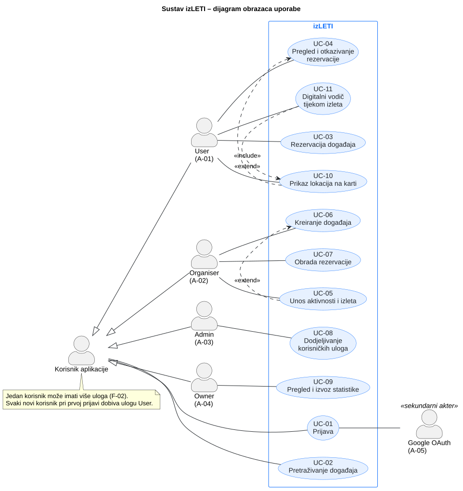

# 3. Obrasci uporabe

Oznake F-01, F-02 itd. odnose se na [analizu zahtjeva](2-Analiza-zahtjeva.md). Prioriteti zahtjeva navedeni su u odjeljku 2.1.

## 3.1 Dijagram obrazaca uporabe

**PlantUML izvor:** [izvor](./puml/3-1-izleti-usecase-UC.puml)

## 3.2 Specifikacije obrazaca uporabe

### UC-01: Prijava

| Element specifikacije | Opis |
| :--- | :--- |
| **Primarni akter** | Korisnik aplikacije (sekundarni: Google OAuth) |
| **Povezani zahtjevi** | F-01, F-02 |
| **Preduvjeti** | Korisnik ima Google račun i nije prijavljen. |
| **Glavni uspješni tok** | 1. Korisnik odabire prijavu Google računom. 2. Aplikacija preusmjerava korisnika na Google. 3. Korisnik se prijavljuje i dopušta pristup. 4. Aplikacija dohvaća korisnikove podatke i uloge te prikazuje funkcionalnosti njegovih uloga. |
| **Alternativni tokovi / Iznimke** | **3a - Korisnik odustaje ili prijava ne uspije:** aplikacija ostaje na početnoj stranici i korisnik ostaje neprijavljen. **4a - Prva prijava:** aplikacija stvara novi korisnički račun s početnom ulogom (početna uloga još nije određena). |
| **Posljedice (ishod)** | Korisnik je prijavljen i vidi funkcionalnosti svojih uloga. |

### UC-02: Pretraživanje događaja

| Element specifikacije | Opis |
| :--- | :--- |
| **Primarni akter** | User |
| **Povezani zahtjevi** | F-08 |
| **Preduvjeti** | Nema. |
| **Glavni uspješni tok** | 1. Korisnik otvara popis događaja. 2. Unosi filtere (naziv, datum, cijena, mjesto polaska, kategorija, trajanje, slobodna mjesta, vodič) i odabire sortiranje. 3. Aplikacija prikazuje događaje koji odgovaraju filterima. |
| **Alternativni tokovi / Iznimke** | **3a - Nema rezultata:** aplikacija javlja da nema događaja za zadane filtere i nudi poništavanje filtera. |
| **Posljedice (ishod)** | Korisnik pronalazi događaje koji ga zanimaju. |

### UC-03: Rezervacija događaja

| Element specifikacije | Opis |
| :--- | :--- |
| **Primarni akter** | User |
| **Povezani zahtjevi** | F-09, F-10, F-15, F-20 |
| **Preduvjeti** | Korisnik je prijavljen; događaj je planiran i ima slobodnih mjesta. |
| **Glavni uspješni tok** | 1. Korisnik odabire događaj i otvara obrazac za rezervaciju. 2. Unosi broj osoba i po želji bira dostupne dodatne usluge. 3. Odabire vodiča na temelju jezika kojim govori i ocjene.  4. Predaje rezervaciju. 5. Aplikacija provjerava slobodna mjesta na događaju i za odabrane usluge i vodiča. 6. Aplikacija sprema rezervaciju s početnim statusom i prikazuje potvrdu predaje. |
| **Alternativni tokovi / Iznimke** | **4a - Nema dovoljno mjesta:** aplikacija javlja koliko je mjesta slobodno, ne sprema rezervaciju i korisnik može promijeniti broj osoba ili usluge. **4b - Događaj se popunio u međuvremenu:** aplikacija odbija rezervaciju i javlja da je događaj popunjen. **5a - Spremanje nije uspjelo:** aplikacija javlja grešku i ne prikazuje lažnu potvrdu. |
| **Posljedice (ishod)** | Rezervacija je spremljena, a broj slobodnih mjesta smanjen. Potvrda e-poštom šalje se nakon potvrde organizatora (UC-07). |

### UC-04: Pregled i otkazivanje rezervacije

| Element specifikacije | Opis |
| :--- | :--- |
| **Primarni akter** | User |
| **Povezani zahtjevi** | F-11 |
| **Preduvjeti** | Korisnik je prijavljen i ima barem jednu rezervaciju za izlet koji još nije održan. |
| **Glavni uspješni tok** | 1. Korisnik otvara svoje rezervacije. 2. Odabire rezervaciju i pregledava status te podatke o izletu i aktivnostima. 3. Po potrebi odabire otkazivanje i potvrđuje ga. 4. Aplikacija mijenja status u otkazanu i oslobađa mjesta. |
| **Alternativni tokovi / Iznimke** | **2a - Prikaz na karti:** korisnik otvara kartu aktivnosti (UC-10). **3a - Korisnik odustaje od otkazivanja:** rezervacija ostaje nepromijenjena. **4a - Otkazivanje nije dopušteno:** aplikacija objašnjava razlog (pravila otkazivanja još nisu definirana). |
| **Posljedice (ishod)** | Korisnik je pregledao rezervaciju ili je rezervacija otkazana. |

### UC-05: Kreiranje aktivnosti

| Element specifikacije | Opis |
| :--- | :--- |
| **Primarni akter** | Organiser |
| **Povezani zahtjevi** | F-04, F-21 |
| **Preduvjeti** | Korisnik je prijavljen i ima ulogu Organiser. |
| **Glavni uspješni tok** | 1. Organizator otvara izradu aktivnosti. 2. Dodaje novu aktivnost (opis, lokacija, kategorija). 3. Nude mu se slike vezane za zadanu lokaciju, bira jednu.  4. Sprema aktivnost. |
| **Alternativni tokovi / Iznimke** | **2a - Nedostaju podaci aktivnosti:** aplikacija označava neispunjena polja i ne sprema aktivnost. **3a - Ne postoji ni jedna slika koja odgovara odabranoj lokaciji:** Aplikacija postavlja generičku *placeholder* sliku za aktivnost. |
| **Posljedice (ishod)** | Aktivnost je spremljena te se može dodati u izlete. |

### UC-05.5 Kreiranje izleta
| Element specifikacije | Opis |
| :--- | :--- |
| **Primarni akter** | Organiser |
| **Povezani zahtjevi** | F-05 |
| **Preduvjeti** | Korisnik je prijavljen i ima ulogu Organiser. |
| **Glavni uspješni tok** | 1. Organizator otvara izradu izleta. 2. Organizator bira aktivnosti od kojih se izlet sastoji te ih poreda u željenom redoslijedu.  3. Postavlja ostale parametre izleta (mjesto polaska, trajanje...)  4. Sprema izlet. |
| **Alternativni tokovi / Iznimke** | **2.a - Ne postoje sve aktivnosti od kojih se izlet sastoji:** aplikacija omogućuje kreiranje novih aktivnosti unutar sučelja za kreiranje izleta. Nakon kreiranja izleta ove aktivnosti se spremaju te se mogu koristiti i u drugim izletima.  **4a - Izlet nema nijednu aktivnost** aplikacija javlja grešku i ne sprema izlet. |

### UC-06: Kreiranje događaja

| Element specifikacije | Opis |
| :--- | :--- |
| **Primarni akteri** | Organiser, Guide |
| **Povezani zahtjevi** | F-06, F-07 |
| **Preduvjeti** | Korisnik je prijavljen i ima ulogu Organiser. |
| **Glavni uspješni tok** | 1. Organizator bira postojeći izlet ili izrađuje novi (UC-05.5). 2. Određuje termin događaja i dodjeljuje vodiče. 3. Unosi kapacitet događaja te dostupne dodatne usluge i njihove kapacitete. 4. Bira stanje događaja (*hidden* ili *scheduled*) koje se kasnije može mijenjati. 5. Sprema događaj. |
| **Alternativni tokovi / Iznimke** | **2a - Nema slobodnog vodiča u terminu:** aplikacija javlja da vodič nije dostupan i organizator bira drugog vodiča ili termin. |
| **Posljedice (ishod)** | Događaj je spremljen te je vidljiv korisnicima ako mu je pridodijeljeno stanje *scheduled*. |

### UC-07: Obrada rezervacije

| Element specifikacije | Opis |
| :--- | :--- |
| **Primarni akter** | Organiser |
| **Povezani zahtjevi** | F-12, F-10 |
| **Preduvjeti** | Korisnik je prijavljen i ima ulogu Organiser; postoji rezervacija koja čeka obradu. |
| **Glavni uspješni tok** | 1. Organizator otvara događaj i njegove rezervacije. 2. Odabire rezervaciju. 3. Potvrđuje je ili odbija. 4. Aplikacija mijenja status rezervacije; kod potvrde šalje korisniku potvrdu e-poštom. |
| **Alternativni tokovi / Iznimke** | **4a - Slanje e-pošte nije uspjelo:** status je promijenjen, a aplikacija bilježi da potvrda nije poslana. **4b - Odbijena rezervacija:** oslobađaju se rezervirana mjesta. |
| **Posljedice (ishod)** | Rezervacija je potvrđena ili odbijena, a korisnik vidi novi status te prima obavijest e-poštom. |

### UC-08: Dodjeljivanje korisničkih uloga

| Element specifikacije | Opis |
| :--- | :--- |
| **Primarni akter** | Admin |
| **Povezani zahtjevi** | F-02, F-03 |
| **Preduvjeti** | Korisnik je prijavljen i ima ulogu Admin. |
| **Glavni uspješni tok** | 1. Administrator pretražuje korisnike. 2. Odabire korisnika i dodjeljuje mu ili oduzima ulogu. 3. Aplikacija sprema promjenu. |
| **Alternativni tokovi / Iznimke** | **1a - Korisnik nije pronađen:** aplikacija prikazuje prazan rezultat. **2a - Admin sam sebi oduzima ulogu Admin:** aplikacija traži potvrdu. |
| **Posljedice (ishod)** | Korisnikove uloge su ažurirane. |

### UC-09: Pregled i izvoz statistike

| Element specifikacije | Opis |
| :--- | :--- |
| **Primarni akter** | Owner |
| **Povezani zahtjevi** | F-13, F-16 |
| **Preduvjeti** | Korisnik je prijavljen i ima ulogu Owner. |
| **Glavni uspješni tok** | 1. Owner otvara stranicu statistike. 2. Odabire razdoblje. 3. Aplikacija prikazuje broj rezervacija, popunjenost, prihode te najtraženije aktivnosti i dodatne usluge. |
| **Alternativni tokovi / Iznimke** | **3a - Izvoz:** Owner odabire izvoz i preuzima podatke u standardnom formatu (npr. CSV). **3b - Nema podataka za razdoblje:** aplikacija prikazuje prazne vrijednosti uz obavijest. |
| **Posljedice (ishod)** | Prikazana je statistika, a po potrebi preuzeta datoteka s podacima. |

### UC-10: Prikaz lokacija na karti

| Element specifikacije | Opis |
| :--- | :--- |
| **Primarni akter** | User |
| **Povezani zahtjevi** | F-11, F-14 |
| **Preduvjeti** | Korisnik ima rezervaciju za neki događaj. |
| **Glavni uspješni tok** | 1. Korisnik otvara prikaz rezervacije ili izleta. 2. Otvara kartu. 3. Aplikacija prikazuje aktivnosti i znamenitosti izleta kao oznake te korisnikov položaj. |
| **Alternativni tokovi / Iznimke** | **3a - Korisnik ne dopusti lokaciju:** karta prikazuje samo aktivnosti bez korisnikova položaja. |
| **Posljedice (ishod)** | Prikazane su lokacije na karti. |

### UC-11: Digitalni vodič tijekom izleta

| Element specifikacije | Opis |
| :--- | :--- |
| **Primarni akter** | User |
| **Povezani zahtjevi** | F-14, F-17 |
| **Preduvjeti** | Korisnik ima potvrđenu rezervaciju za događaj koji je u tijeku i koristi aplikaciju na mobilnom uređaju. |
| **Glavni uspješni tok** | 1. Korisnik otvara rezervaciju za izlet u tijeku i dopušta pristup lokaciji. 2. Aplikacija prati korisnikovu GPS lokaciju i prikazuje je na karti s aktivnostima izleta. 3. Kada korisnik dođe u blizinu aktivnosti, aplikacija prikazuje njezin naziv, opis i zanimljivosti. |
| **Alternativni tokovi / Iznimke** | **1a - Korisnik ne dopusti lokaciju:** aplikacija prikazuje kartu i popis aktivnosti, a informacije korisnik otvara ručno. **2a - GPS signal nije dostupan:** aplikacija javlja da lokacija trenutno nije poznata i nastavlja kada se signal vrati. |
| **Posljedice (ishod)** | Korisnik dobiva informacije o lokacijama koje posjećuje. |

### UC-12: Recenzije izleta i vodiča
| Element specifikacije | Opis |
| :--- | :--- |
| **Primarni akteri** | User, Guide |
| **Povezani zahtjevi** | F-18, F-19 |
| **Preduvjeti** | Korisnik ima rezervaciju za događaj koji je završio. |
| **Glavni uspješni tok** | 1. Korisnik ocjenjuje izlet.   2. Korisnik ostavlja komentar na izlet.   3. Korisnik ocjenjuje pridruženog vodiča.   (sva tri koraka su opcionalna)|
| **Alternativni tokovi / Iznimke** | **1a - Korisnik je već ocijenio taj događaj:** aplikacija prikazuje korisnikovu bivšu ocjenu te mu dopušta da ju promijeni.  **2a - Korisnik je već ostavio komentar na taj događaj:** aplikacija prikazuje korisnikov bivši komentar te mu dopušta da ga promijeni.  **3a - Korisnik je već ocijenio tog vodiča za taj događaj:** aplikacija prikazuje korisnikovu bivšu ocjenu te mu dopušta da ju promijeni.|
| **Posljedice (ishod)** | Mijenjaju se prosječne ocjene izleta i vodiča. Pri rezervaciji budućih događaja vezanih za isti izlet vidi se komentar. |

## 3.3 Provjera dosljednosti obrazaca uporabe

Povezivanje zahtjev - obrazac uporabe - ispitivanje održava se samo u [tablici sljedivosti zahtjeva](2-Analiza-zahtjeva.md#26-sljedivost-zahtjeva).

| Provjera | Stanje |
| --- | --- |
| Zahtjev | Svaki obrazac uporabe povezan je s postojećim zahtjevom iz [2.1](./2-Analiza-zahtjeva.md#21-funkcijski-zahtjevi) |
| Akter | Akteri odgovaraju ulogama iz [2.3](./2-Analiza-zahtjeva.md#23-dionici-i-akteri) |
