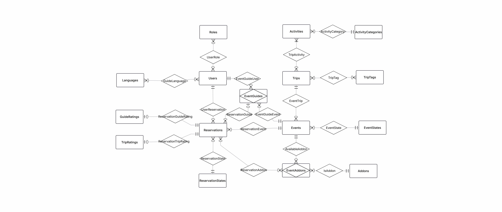
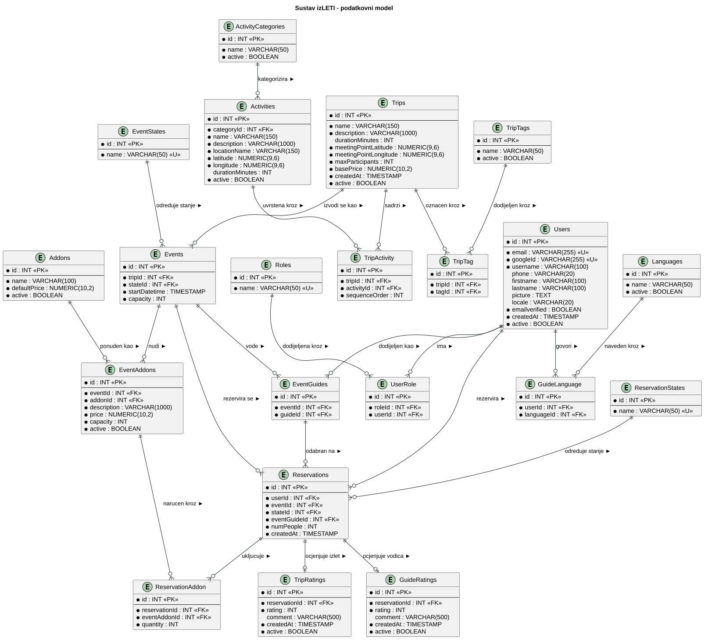
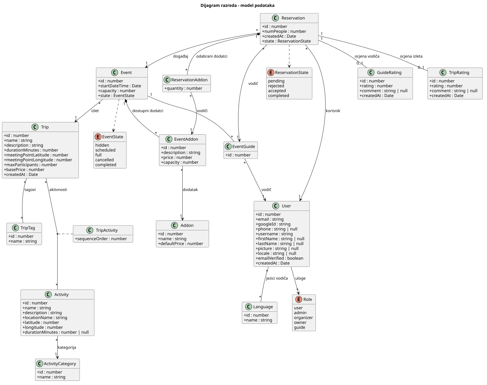

# 4. Arhitektura i oblikovanje

| Arhitekturni pogled | Ključno inženjersko pitanje | Primijenjeni model ili dijagram |
| :--- | :--- | :--- |
| **Strategija rješenja** | Koji stil i temeljne odluke određuju program? | Tablica odluka (odjeljak [4.1](#41-ključne-arhitekturne-odluke)) |
| **Struktura podsustava** | Koji su glavni dijelovi i kako komuniciraju? | Dijagram komponenata |
| **Model podataka** | Kako su strukturirani trajni podaci programa? | Relacijski ER dijagram |
| **Struktura koda** | Kako su dodijeljene odgovornosti i ključne klase? | Reprezentativni dijagram razreda |
| **Dinamičko ponašanje** | Kako moduli surađuju pri obradi ključnih transakcija? | Sekvencijski dijagram |
| **Stanja sustava** | Kako ključni domenski objekt mijenja svoja stanja? | Dijagram stanja |
| **Fizički razmještaj** | Na kojim se izvršnim čvorovima program izvodi? | Dijagram razmještaja (poglavlje 6) |

---

## 4.1 Ključne arhitekturne odluke

| Odluka | Razmatrana alternativa | Projektno specifično obrazloženje i kompromis |
| --- | --- | --- |
| Odvajanje poslužiteljskih ruta, modela i prikaza | — | [ADR-01](#adr-01) |
| Poslužiteljsko generiranje HTML prikaza | Renderiranje na klijentskoj strani | Budući da se velik dio aplikacije temelji na prikazu podataka, obrazaca i popisa, poslužiteljsko generiranje prikaza pojednostavljuje razvoj i smanjuje potrebu za složenijom klijentskom logikom. Kompromis je što su za dio interakcija potrebni dodatni zahtjevi poslužitelju i ponovno generiranje prikaza. |
| Relacijska pohrana podataka | — | Podaci aplikacije imaju jasno definirane međusobne odnose, primjerice između korisnika, rezervacija, događaja, izleta i aktivnosti. Relacijski model omogućuje dosljedno povezivanje podataka i očuvanje ograničenja stranih ključeva. Kompromis je potreba za unaprijed definiranom strukturom baze i migracijama prilikom promjena modela podataka. |
| Odvajanje pojmova aktivnost, izlet i događaj | Svaki događaj se kreira zasebno | [ADR-02](#adr-02) |
| Prijava korisnika putem Google OAutha | Lokalna prijava putem e-pošte i lozinke | Korištenje Google računa uklanja potrebu za implementacijom vlastitog sustava lozinki i njihovom sigurnom pohranom u bazi. Aplikacija i dalje vodi vlastite korisničke račune i uloge. Kompromis je ovisnost o vanjskom pružatelju identiteta. |
| Podrška za više korisničkih uloga po računu | Samo jedna uloga po računu | Jedan korisnik može imati više uloga, a dostupne funkcionalnosti ovise o dodijeljenim ulogama. Time se omogućuje da isti korisnik, primjerice, bude i administrator i organizator. Kompromis je složenije upravljanje dodjelom uloga i povezanim funkcionalnostima korisničkog računa. |
| Kontrola pristupa pomoću poslužiteljske provjere korisničkih ovlasti | — | Ovlasti se provjeravaju na poslužiteljskoj strani kako korisnici ne bi mogli pristupiti funkcionalnostima drugih uloga izravnim slanjem zahtjeva. Time se zaštita ne oslanja samo na skrivanje pojedinih elemenata sučelja. Kompromis je potreba za dosljednom provjerom ovlasti na svim zaštićenim rutama. |
| Digitalni vodić za korištenje na mobitelu kao dio web aplikacije | Zasebna mobilna aplikacija | [ADR-03](#adr-03) |
| Globalni generički dodatci koji se pridodjeljuju događaju | Dodatci specifični za izlet | Korištenjem globalnih dodataka kojima se pri dodjeljivanju događaju dodaju detalji omogućuje jednostavniju strukturu podatka te statistiku za dodatke. Ovakav pristup je malo više ograničavajući za organizatore jer ne mogu napraviti dodatak specifično za potrebe pojedinog izleta.
| Slike se za aktivnosti se povlače sa Google Places API-ja | Upload slike za aktivnost | Ovako izbjegavamo upload datoteka na poslužitelj što može dovesti do sigurnosnih propusta i zahtijevati kompliciraniju konfiguraciju hostinga. Također ovo ubrzava proces izradnje aktivnosti, ali i smanjuje slobodu korisnika da koristi željenu sliku. |

## 4.2 Gradivni blokovi i UML dijagram komponenata

**Cilj:** Prikazati logičku podjelu programa na komponente, njihova sučelja i vanjske integracije. Dijagram komponenata prikazuje logičku organizaciju, dok dijagram razmještaja prikazuje fizičko izvođenje. Ovaj prikaz ažurirajte kako sustav poprima konačan oblik.

**Napomena:** ovaj dio dokumentacije još nije izrađen
**Dijagram komponenata:** Dijagram nije izrađen

## 4.3 Model podataka i oblikovanje razreda

[Detaljan opis strukture baze podataka](./baza/baza.md)

### 4.3.1 ER dijagram i model podataka

**Cilj:** Prikazati važne pohranjene entitete, njihove identifikatore i veze te dovoljno atributa za razumijevanje podataka aplikacije. ER dijagram odvojen je od reprezentativnog UML dijagrama razreda u nastavku.

**ER dijagrami:**  

**Slika 4.2.1 Konceptualni ER dijagram sustava izLETI**
 

**Slika 4.2.2 Implementacijski ER dijagram sustava izLETI**  
**Izvor dijagrama:** [izvor](./puml/4-2-izleti-data-ERD.puml)  
**Implementacija:** [implementacija](./baza/schema.sql)

### 4.3.2 Reprezentativni UML dijagram razreda

**Dijagram razreda:** 

**Slika 4.3 Dijagram razreda modela podataka**
**PlantUML izvor:** [izvor](./puml/model_class_diagram.puml)
**Referenca na kod pri završnom pregledu:** [implementacija](/src/model)

## 4.4 Ponašanje tijekom izvođenja

### 4.4.1 Reprezentativni UML sekvencijski dijagram

**Cilj:** Prikazati redoslijed poruka za jedan reprezentativni scenarij i odgovore na važnu alternativu.

**Scenarij:** Nije određen
**sekvencijski dijagram:** Dijagram još nije izrađen

### 4.4.2 Reprezentativni UML dijagram stanja

**Cilj:** Prikazati važna stanja jednog domenskog objekta ili eksplicitno upravljanog načina rada sustava te događaje ili uvjete koji ih mijenjaju.

**Vlasnik stanja i razlog odabira:** Nije određen
**Dijagram stanja:** Dijagram još nije izrađen

## 4.5 Zapisi arhitekturnih odluka

#### ADR-01: Odvajanje pojmova aktivnost, izlet i događaj

| Polje | Zapis odluke |
| --- | --- |
| Kontekst i cilj | U aplikaciji je potrebno omogućiti ponovnu uporabu aktivnosti i izleta te njihovo održavanje u različitim terminima. Pritom je potrebno razlikovati izlet kao cjelinu koja se može organizirati od konkretnog događaja, odnosno pojedinog održavanja izleta. Rezervacija se mora odnositi na konkretan termin održavanja. |
| Kriteriji odluke | Omogućiti ponovnu uporabu aktivnosti u više izleta, održavanje istog izleta u više termina te definiranje specifičnih podataka za svaki termin, poput vodiča i kapaciteta. Model treba omogućiti povezivanje rezervacije s konkretnim događajem. |
| Razmatrane alternative | Svaki događaj kreirati zasebno, bez zasebnog modeliranja pojmova aktivnosti, izleta i događaja. |
| Odluka i obrazloženje | Odvojiti pojmove aktivnosti, izleta i događaja kao zasebne modele. Aktivnost se može koristiti u više izleta, dok se isti izlet može održavati u više različitih termina. Za svaki događaj definiraju se termin, vodič i kapacitet, a rezervacija se veže uz konkretan događaj. Time se omogućuje ponovna uporaba aktivnosti i izleta, uz prihvaćanje većeg broja povezanih entiteta i složenijeg povezivanja podataka. |
| Status | Prihvaćeno |

#### ADR-02: Globalni generički dodatci koji se pridodjeljuju događaju

| Polje | Zapis odluke |
| --- | --- |
| Kontekst i cilj | Aplikacija omogućuje dodjeljivanje dodataka događajima. Potrebno je odabrati način modeliranja dodataka koji omogućuje njihovu ponovnu uporabu i jednostavnije praćenje statistike. |
| Kriteriji odluke | Pojednostaviti strukturu podataka, omogućiti ponovnu uporabu dodataka te omogućiti vođenje statistike za pojedine dodatke. |
| Razmatrane alternative | Definiranje dodataka specifičnih za pojedini izlet. |
| Odluka i obrazloženje | Koristiti globalne generičke dodatke koji se pridodjeljuju događaju. Prilikom dodjeljivanja događaju definiraju se potrebni detalji dodatka. Time se pojednostavljuje struktura podataka i omogućuje lakše praćenje statistike za dodatke. Kompromis je smanjena fleksibilnost organizatora jer ne mogu definirati dodatke specifične za potrebe pojedinog izleta. |
| Status | Prihvaćeno |

#### ADR-03: Globalni generički dodatci koji se pridodjeljuju događaju

| Polje | Zapis odluke |
| --- | --- |
| Kontekst i cilj | Aplikacija objedinjuje pregled i rezervaciju izleta s digitalnim vodičem koji korisnici koriste tijekom izleta. Potrebno je odabrati platformu na kojoj će digitalni vodič biti dostupan, uzimajući u obzir opseg razvoja i održavanja aplikacije. |
| Kriteriji odluke | Objediniti pregled, rezervaciju i korištenje digitalnog vodiča u jednoj aplikaciji. Izbjeći dodatni razvoj i održavanje zasebne mobilne aplikacije. Omogućiti korištenje na mobilnim uređajima. |
| Razmatrane alternative | Razvoj zasebne mobilne aplikacije za korištenje digitalnog vodiča. |
| Odluka i obrazloženje | Digitalni vodič implementirati kao dio postojeće web-aplikacije, prilagođene korištenju na mobilnim uređajima. Time se izbjegava razvoj i održavanje zasebne mobilne aplikacije te se pregled i rezervacija izleta objedinjuju s digitalnim vodičem. Kompromisi su potreba za prilagodbom sučelja različitim načinima korištenja aplikacije te ovisnost o mogućnostima preglednika i dopuštenju korisnika za pristup lokaciji. |
| Status | Prihvaćeno |

ADR pišite samo za odluku čije će obrazloženje ostati važno i nakon promjene implementacije. Značajna promjena odluke može se zabilježiti novim ADR-om koji zamjenjuje stari; rutinski odabiri alata ne trebaju detaljne zapise. Promjene dogovorenog opsega pripadaju zahtjevima i njihovoj povijesti promjena; povratna informacija o zadatku ostaje uz odgovarajući zadatak.

## 4.6 Zajednička pravila oblikovanja (engl. Cross-cutting concerns)

**Implementirani mehanizmi:**

| Aspekt | Mehanizam | Pravilo | Mjesto primjene |
| --- | --- | --- | --- |
| Sigurnost | Pristup ograničen u skladu s ulogama | Za svaki zahtijev se provjeravaju uloge te se na poslužiteljskoj strani određuje ima li korisnik pravo pristupiti ruti. | [middleware](/src/middleware/authorization.ts)
| Validacija podataka | Provjera valjanosti podataka | Provjera valjanosti podataka radi se na korisničkoj strani, zatim na poslužitelju te na kraju i u bazi podatka. | [shema baze](./baza/schema.sql), [model podataka](/src/model/)
|Smanjenje međuovisnosti | Pristup bazi podataka | Pristup bazi podataka omogućen je isključivo kroz sučelje koje pruža model podataka | [model podataka](/src/model/)
| Struktura baze podataka | Surogat id stupac | Za sve tablice uvodi se stupac 'id' zbog lakšeg upravljanja bazom podataka | [dijagram baze](./assets/diagrams/4-2-izleti-data-ERD.svg)

## 4.7 Arhitekturni rizici i tehnički dug

**Cilj:** Navesti stvarne tehničke ili domenske rizike i svjesno prihvaćene kompromise oblikovanja, njihove posljedice i način na koji ih tim obrađuje.

**Tehnički rizici i dug**

| Rizik ili kompromis | Posljedica | Odgovor na rizik  |
| --- | --- | --- |
| Postavljanje aplikacije na vlastiti poslužitelj | Potencijalni sigurnosni propusti, nedostatak službene tehničke podrške | Praćenje sigurnosnih dobrih praksi. |
| Profilna slika se učitava direktno sa Google servera | Google ponekad blokira zahtijev sa greškom `429 Too Many Requests` te se slika ne učitava ispravno | U budućnosti implementirati spremanje slike na poslužitelju kako se ne bi slali česti zahtijevi na Google API. |

**Poslovni ili domenski rizici, ako su značajni**

| Rizik | Posljedica | Odgovor na rizik |
| --- | --- | --- |
| Ovisnost o vanjskim pružateljima usluga | Nedostupnost Google OAutha, usluge za slanje e-pošte ili kartografskih usluga može otežati prijavu, potvrdu rezervacije ili korištenje digitalnog vodiča. | Predvidjeti razumljive poruke o pogreškama i omogućiti korištenje dijelova aplikacije koji ne ovise o nedostupnoj usluzi. |
| Istovremeno rezerviranje posljednjih slobodnih mjesta | Više korisnika može istodobno pokušati rezervirati isto posljednje slobodno mjesto, što može dovesti do prekoračenja kapaciteta događaja. | Provjeru i zauzimanje kapaciteta provoditi kao transakciju. |
| Nedostupnost odgovarajuće slike na Google Places API-ju | Može dovesti do aktivnosti bez slike ili aktivnosti sa neodgovarajućom slikom | Ako nisu pronađene slike ili slike nisu odgovarjuće pruža se opcija *placeholder* slike. |

---