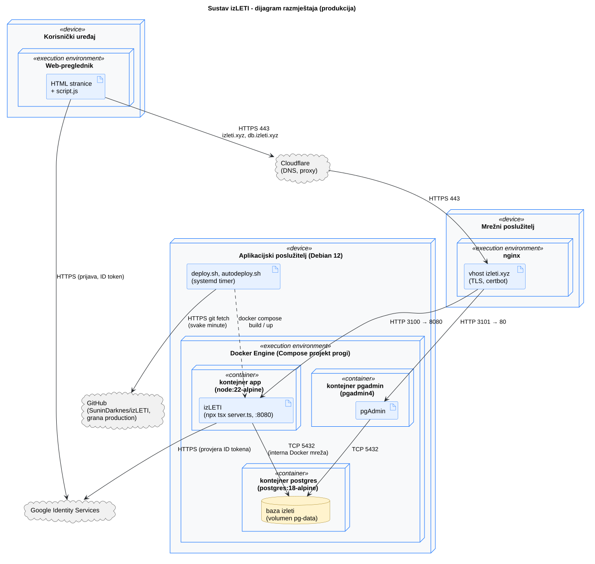

# 6. Postavljanje, instalacija i konfiguracija

**Cilj:** Detaljno dokumentirati topologiju izvođenja, postupak lokalne instalacije i konfiguracije iz izvornog koda te način javnog postavljanja i administracije programa. [README](../README.md) navodi javnu adresu i sažeti postupak lokalnog pokretanja; ova stranica donosi potpun inženjerski postupak koji osigurava točnu ponovljivost na drugom računalu.

---

## 6.1 Prikaz razmještaja

**Cilj:** Prikazati okruženja izvođenja, raspodijeljene dijelove programa, spremište podataka i relevantne vanjske usluge. Njihovu komunikaciju i mrežne protokole prikažite jednim UML dijagramom razmještaja. Dok dijagram komponenata iz Poglavlja 4 prikazuje logičke odgovornosti, dijagram razmještaja pokazuje gdje se izvršni artefakti fizički ili virtualno izvode.

**Dijagram razmještaja:**  
  
**PlantUML izvor:** [izvor](./puml/6-1-izleti-deployment-DD.puml)  
**Javno dostupna aplikacija:** [izleti.xyz](https://izleti.xyz)

**Analiza razmještaja:**
* **Korisnički uređaj:** Web-preglednik prima HTML stranice koje generira poslužitelj (EJS) te klijentske skripte. Preglednik izravno komunicira s Google Identity Services radi prijave i dobivanja ID tokena, koji zatim šalje poslužitelju.
* **Cloudflare:** DNS za domenu `izleti.xyz` i proxy. Promet od preglednika do Cloudflarea i od Cloudflarea do nginxa ide preko HTTPS-a (port 443).
* **Mrežni poslužitelj (nginx):** Obrnuti proxy koji završava TLS vezu (certifikat Let's Encrypt, certbot) i prosljeđuje zahtjeve aplikacijskom poslužitelju preko HTTP-a u lokalnoj mreži: `izleti.xyz` na aplikaciju, `db.izleti.xyz` na pgAdmin.
* **Aplikacijski poslužitelj:** Debian 12 s Docker Engineom. Sustav se pokreće kao Docker Compose projekt s tri kontejnera:
  * `app`: Node.js aplikacija (Express, `npx tsx server.ts`, port 8080),
  * `postgres`: PostgreSQL 18 s podacima u Docker volumenu,
  * `pgadmin`: web-sučelje za pregled baze, dostupno samo ovlaštenim članovima tima.
* **Baza podataka:** Dostupna je samo iz interne Docker mreže (aplikacija i pgAdmin) i lokalno na poslužitelju. Preglednik joj nikad ne pristupa izravno.
* **Vanjske usluge:** Google Identity Services (prijava; poslužitelj provjerava ID token preko HTTPS-a) i GitHub, s kojeg skripta za automatsko postavljanje svake minute dohvaća granu `production` (vidi 6.3).

---

## 6.2 Lokalna instalacija i konfiguracija

1. **Preduvjeti i preuzimanje izvornog koda:**

   Preduvjeti:
      - PostgreSQL 18.6
      - NodeJS v24.16.0
      - npm 11.13.0

   Preuzimanje izvornog koda
   ```bash
   git clone https://github.com/SuninDarknesizLETI.git
   ```

   <a id="lokalna-konfiguracija-env"></a>
2. **Ovisnosti i konfiguracijske varijable:**
   - koniguracijske varijable nalaze se u datoteci [.env.example](/.env.example)

   | Konfiguracijska varijabla | Način konfiguriranja | Naputak |
   | --- | --- | --- |
   | PORT | Odabrati port po želji. | Ako se polje izostavi koristi se port 8080. Na javnoj stranici koristiti port 8080 koji se nalazi iza reverse proxya.|
   | GOOGLE_CLIENT_ID | Konfigurirati Google klijent i staviti odgovarajući id. | Ako se polje izostavi koristi se naš id koji je konfiguriran da radi sa localhost:8080. |
   | SESSION_SECRET | Napisati dugi nasumični niz znakova. | Preporučeno: https://generate-random.org/session-secrets
   | DB_HOST | Adresa na kojoj se nalazi baza podataka | Najčešće localhost |
   | DB_PORT | Port na kojem sluša baza podataka | Najčešće 5432 |
   | DB_NAME | Naziv baze koji ste postavili prilikom konfiguracije baze | |
   | DB_USER | Naziv korisnika koji se koristi za pristup bazi | Ne preporuča se korištenje korisnika sa punim dozvolama |
   | DB_PASSWORD | Lozinka korisnika koji se koristi za pristup bazi | |

3. **Inicijalizacija baze podataka i migracije:**
   - Za inicijalizaciju baze podataka preporuča se korištenje alata pgAdmin.
   - U pgAdminu napravi se nova baza podataka, te se prilikom kreiranja konfigurira naziv baze i port.
   - Na novoj bazi pokreće se Query tool u koji se kopira sadržaj [sheme baze podataka](./baza/schema.sql). Nakon toga po potrebi se pokreće [skripta za punjenje baze dummy podatcima](./baza/dummy_data.sql).
   - prva uloga administratora dodjeljuje se direktno u bazi (ostale uloge dodjeljuje administrator kroz admin sučelje)
      - prvo je potrebno prijaviti se računom koji će biti administrator kako bi se dodao u bazu
      - zatim u Query tool pokrenuti upit iz [datoteke](./baza/dodavanje_uloge.sql) (zamijeniti `[EMAIL]` sa email adresom računa administratora)
4. **Pokretanje i verifikacija:**
   - za lokalno pokretanje vidi [brzi početak](/README.md#quick-start)

---

## 6.3 Javno postavljanje i administracija

Aplikacija nije postavljena na platformu u oblaku (PaaS), nego na **vlastiti Linux poslužitelj** (Debian 12) na kojem se svi dijelovi sustava izvode u **Docker kontejnerima** pomoću Docker Composea. Ispred poslužitelja nalaze se Cloudflare (DNS i proxy) i nginx obrnuti proxy (engl. *reverse proxy*) koji završava HTTPS vezu.

- **Produkcija:** [https://izleti.xyz](https://izleti.xyz) - grana `production`
- **Testno okruženje:** [https://testizleti.dfservers.com](https://testizleti.dfservers.com) - grana `main`, zasebna baza s ispitnim (dummy) podacima
- **Administracija baze (pgAdmin):** [https://db.izleti.xyz](https://db.izleti.xyz) - samo za ovlaštene članove tima

Tijek zahtjeva: preglednik → Cloudflare (HTTPS) → nginx (HTTPS, certifikat Let's Encrypt / certbot) → Docker kontejner `app` (Node.js, port 8080) → Docker kontejner `postgres` (interna Docker mreža, port 5432).

| **Postavljeni podsustav** | **Infrastruktura i izvor koda** | **Naredbe izgradnje i pokretanja** | **Konfiguracija i varijable okruženja** |
| --- | --- | --- | --- |
| **Klijentski dio** | Nema zasebnog postavljanja. HTML generira poslužitelj (EJS predlošci iz `src/views/`), a statičke datoteke (`src/public/`) poslužuje Express. | - (dio slike poslužiteljskog dijela) | Nema varijabli vidljivih pregledniku osim `GOOGLE_CLIENT_ID`, koji nije tajna vrijednost. |
| **Poslužiteljski dio** | Docker kontejner `app` na vlastitom poslužitelju; grana `production`, mapa `src/`. Slika se gradi iz `node:22-alpine`. | Izgradnja: `docker compose build app` (unutar slike `npm ci`). Pokretanje: `docker compose up -d`, u kontejneru `npx tsx server.ts`. | `SESSION_SECRET`, `GOOGLE_CLIENT_ID`, `GOOGLE_CLIENT_SECRET`, `DB_HOST`, `DB_PORT`, `DB_NAME`, `DB_USER`, `DB_PASSWORD`. `NODE_ENV=production` postavljen je u slici. Port 8080 (zadana vrijednost, `PORT` se ne postavlja). |
| **Baza podataka** | Docker kontejner `postgres:18-alpine` na istom poslužitelju; podaci u Docker volumenu `pg-data`. Nije javno dostupna (samo `127.0.0.1:5432` na poslužitelju i interna Docker mreža). | Shema [`docs/baza/schema.sql`](./baza/schema.sql) primjenjuje se **jednom**, na praznu bazu. Alat za migracije se ne koristi; kasnije promjene sheme primjenjuju se ručno SQL skriptom. | `POSTGRES_DB`, `POSTGRES_USER`, `POSTGRES_PASSWORD`, `POSTGRES_RO_PASSWORD` |
| **pgAdmin** | Docker kontejner `dpage/pgadmin4:9.18`, isti poslužitelj, iza nginxa na `db.izleti.xyz`. | Pokreće se zajedno s ostatkom (`docker compose up -d`). | `PGADMIN_EMAIL`, `PGADMIN_PASSWORD` (samo za prvo pokretanje) |

### Konfiguracijske varijable

Sve vrijednosti nalaze se u datoteci `.env` **na poslužitelju** (`/opt/progi-deploy/.env`, prava `640`, vlasnik `root`). Ta datoteka nikad nije u Gitu. Vrijednosti čuva član tima zadužen za postavljanje (Florijan Gotal); novi održavatelj ih dobiva od njega privatno, ne kroz repozitorij ni javne kanale.

| Varijabla | Svrha | Odakle vrijednost | Koja usluga je koristi |
| --- | --- | --- | --- |
| `SESSION_SECRET` | Potpisivanje kolačića sesije. U produkciji je obavezna (aplikacija se bez nje ne pokreće). | Generira se nasumično, npr. `openssl rand -hex 32`. | `app` |
| `GOOGLE_CLIENT_ID` | ID Google OAuth klijenta za prijavu. Nije tajna. | Google Cloud Console → *APIs & Services → Credentials*. Kao *Authorized JavaScript origin* mora biti upisano `https://izleti.xyz`. | `app` |
| `GOOGLE_CLIENT_SECRET` | Tajni ključ istog OAuth klijenta (trenutačno ga kod ne koristi). | Google Cloud Console | `app` |
| `POSTGRES_DB`, `POSTGRES_USER`, `POSTGRES_PASSWORD` | Naziv baze, korisnik i lozinka. Isti se podaci prosljeđuju aplikaciji kao `DB_NAME`, `DB_USER`, `DB_PASSWORD`. | Lozinka se generira nasumično. | `postgres`, `app` |
| `DB_HOST`, `DB_PORT` | Adresa baze za aplikaciju. Fiksno `postgres` i `5432` (naziv servisa u Docker mreži), postavljeno u `docker-compose.yml`. | - | `app` |
| `POSTGRES_RO_PASSWORD` | Lozinka uloge `progi_ro` koja smije samo čitati bazu (pregled podataka kroz pgAdmin). | Generira se nasumično. | `postgres` |
| `PGADMIN_EMAIL`, `PGADMIN_PASSWORD` | Početni administratorski račun pgAdmina; lozinka se nakon prve prijave mijenja u sučelju. | Odabire administrator. | `pgadmin` |
| `APP_BIND` | Adresa i port na kojima je aplikacija dostupna nginxu (npr. `192.168.1.6:3100`). | Ovisi o mreži poslužitelja. | `app` |

### Kontinuirana integracija i postavljanje

Projekt koristi **automatsko postavljanje iz grane `production`**, ali **nema kontinuirane integracije**: testovi iz mape `tests/` ne pokreću se automatski prije postavljanja. Jedine automatske provjere prije nego što nova inačica zamijeni staru su uspješna izgradnja Docker slike i provjera ispravnosti (`/health`, koji provjerava i vezu s bazom). Ako jedna od njih ne uspije, stara inačica ostaje aktivna. Zato ovaj postupak ne nazivamo kontinuiranim postavljanjem u punom smislu.

Postavljanje radi na načelu povlačenja (engl. *pull*): poslužitelj sam provjerava GitHub, pa GitHub Actions i otvoreni dolazni portovi nisu potrebni.

1. systemd timer `progi-autodeploy.timer` svake minute pokreće `/opt/progi-deploy/autodeploy.sh` (kao neprivilegirani korisnik `progi-runner`).
2. Skripta radi `git fetch` grane `production`. Ako postoji novi commit, pokreće `deploy.sh`, koji redom:
   1. prebaci radnu kopiju `/srv/progi` na novi commit,
   2. izgradi novu sliku (`docker compose build app`); ako izgradnja ne uspije, ništa se ne mijenja,
   3. napravi sigurnosnu kopiju baze (`pg_dump`),
   4. pokrene novu inačicu (`docker compose up -d`),
   5. čeka do 120 s da `/health` unutar kontejnera vrati `{"status":"ok"}`,
   6. ako provjera ne uspije, **automatski vraća** prethodnu sliku i prethodni commit.
3. Commit čije postavljanje nije uspjelo ne pokušava se ponovno. Potrebno je poslati ispravak u `production` ili postavljanje pokrenuti ručno.

Testno okruženje radi na isti način (`progi-test-autodeploy.timer`, `/opt/progi-test-deploy/`), ali prati granu `main` i ne radi sigurnosnu kopiju baze.

### Docker konfiguracija

Docker datoteke nalaze se samo na poslužitelju (`/opt/progi-deploy/`), ne u repozitoriju, tako da repozitorij sadrži isključivo kod aplikacije. Kako bi postavljanje bilo ponovljivo, njihov je sadržaj naveden ovdje. Datoteke su neznatno skraćene: izostavljeni su komentari i postavke vezane uz našu lokalnu mrežu, a adrese su zamijenjene s `127.0.0.1`.

<details>
<summary><strong><code>Dockerfile</code></strong> (kontekst izgradnje: mapa <code>src/</code>)</summary>

```dockerfile
FROM node:22-alpine
WORKDIR /app
ENV NODE_ENV=production
COPY package.json package-lock.json* ./
# tsx je devDependency, ali njime se pokreće aplikacija, pa se instalira sve
RUN npm ci --include=dev --no-audit --no-fund
COPY . .
USER node
EXPOSE 8080
HEALTHCHECK --interval=30s --timeout=5s --start-period=20s --retries=3 \
  CMD wget -qO- http://127.0.0.1:8080/health || exit 1
CMD ["npx", "tsx", "server.ts"]
```

`Dockerfile.dockerignore` (isključuje lokalne datoteke iz slike):

```
node_modules
dist
.env
.env.*
*.log
```
</details>

<details>
<summary><strong><code>docker-compose.yml</code></strong></summary>

```yaml
name: progi

services:
  app:
    build:
      context: /srv/progi/src
      dockerfile: /opt/progi-deploy/Dockerfile
    image: progi-app:latest
    restart: unless-stopped
    init: true
    depends_on:
      postgres:
        condition: service_healthy
    environment:
      SESSION_SECRET: ${SESSION_SECRET}
      GOOGLE_CLIENT_ID: ${GOOGLE_CLIENT_ID}
      GOOGLE_CLIENT_SECRET: ${GOOGLE_CLIENT_SECRET}
      DB_HOST: postgres
      DB_PORT: "5432"
      DB_NAME: ${POSTGRES_DB}
      DB_USER: ${POSTGRES_USER}
      DB_PASSWORD: ${POSTGRES_PASSWORD}
    ports:
      - "${APP_BIND:-127.0.0.1:3100}:8080"   # dostupno samo nginxu
    networks: [backend]

  postgres:
    image: postgres:18-alpine
    restart: unless-stopped
    environment:
      POSTGRES_DB: ${POSTGRES_DB}
      POSTGRES_USER: ${POSTGRES_USER}
      POSTGRES_PASSWORD: ${POSTGRES_PASSWORD}
      POSTGRES_RO_PASSWORD: ${POSTGRES_RO_PASSWORD:-}
    volumes:
      - pg-data:/var/lib/postgresql
      - ./db-init:/docker-entrypoint-initdb.d:ro   # izvodi se samo nad praznim volumenom
    ports:
      - "127.0.0.1:5432:5432"                      # samo lokalno na poslužitelju
    networks: [backend]
    healthcheck:
      test: ["CMD-SHELL", "pg_isready -U \"$$POSTGRES_USER\" -d \"$$POSTGRES_DB\""]
      interval: 10s
      timeout: 5s
      retries: 10
      start_period: 30s

  pgadmin:
    image: dpage/pgadmin4:9.18
    restart: unless-stopped
    depends_on:
      postgres:
        condition: service_healthy
    environment:
      PGADMIN_DEFAULT_EMAIL: ${PGADMIN_EMAIL}
      PGADMIN_DEFAULT_PASSWORD: ${PGADMIN_PASSWORD}
      PGADMIN_CONFIG_SERVER_MODE: "True"
      PGADMIN_CONFIG_PROXY_X_FOR_COUNT: "1"
      PGADMIN_CONFIG_PROXY_X_PROTO_COUNT: "1"
      PGADMIN_CONFIG_PROXY_X_HOST_COUNT: "1"
      PGADMIN_CONFIG_SESSION_COOKIE_SECURE: "True"
    volumes:
      - pgadmin-data:/var/lib/pgadmin
      - ./pgadmin/servers.json:/pgadmin4/servers.json:ro
    ports:
      - "127.0.0.1:3101:80"
    networks: [backend]

volumes:
  pg-data:
  pgadmin-data:

networks:
  backend:
```
</details>

### Postupak postavljanja

Postupak je napisan za čisti Linux poslužitelj. Naredbe `docker` izvode se kao `root` ili kroz `sudo`.

0. **Preduvjeti:** Linux poslužitelj s Docker Engineom i Docker Compose dodatkom (`docker compose version`), `git`, domena čiji DNS zapis pokazuje na poslužitelj te nginx s certbotom (može biti i na drugom računalu u istoj mreži).

1. **Preuzimanje koda (grana `production`):**
   ```bash
   sudo git clone --branch production https://github.com/SuninDarknes/izLETI.git /srv/progi
   ```

2. **Docker konfiguracija:** u `/opt/progi-deploy/` smjestiti `Dockerfile`, `Dockerfile.dockerignore` i `docker-compose.yml` (sadržaj gore), praznu mapu `db-init/` i datoteku `.env` sa svim varijablama iz tablice. Tajne vrijednosti generirati, npr. `openssl rand -hex 32`, zatim zaštititi datoteku:
   ```bash
   sudo chmod 640 /opt/progi-deploy/.env
   ```

3. **Infrastruktura baze podataka:** pokrenuti samo bazu i jednom primijeniti shemu:
   ```bash
   cd /opt/progi-deploy
   sudo docker compose up -d --wait postgres
   sudo docker compose exec -T postgres sh -c 'psql -U "$POSTGRES_USER" -d "$POSTGRES_DB"' \
     < /srv/progi/docs/baza/schema.sql
   ```
   Shemu je moguće primijeniti i automatski: ako se prije prvog pokretanja kopira u `db-init/01-schema.sql`, Postgres je izvede pri stvaranju praznog volumena (tako je postavljeno testno okruženje, gdje se dodatno učitava `dummy_data.sql`). Produkcijska baza **ne** sadrži ispitne podatke. Hardkodirane tablice (npr. uloge `Admin`, `User`, `Owner`, `Guide`, `Organizer` u tablici `roles`) potrebno je upisati ručno, jer bez njih prijava novog korisnika ne uspijeva.

4. **Izgradnja i pokretanje poslužiteljskog dijela:**
   ```bash
   sudo docker compose build app
   sudo docker compose up -d
   sudo docker compose ps                    # svi servisi trebaju biti "healthy"
   curl http://127.0.0.1:3100/health         # očekivano: {"status":"ok"}
   ```

5. **Završno povezivanje (nginx, HTTPS, DNS):** nginx prosljeđuje promet domene na port aplikacije i postavlja zaglavlja `X-Forwarded-*`. Aplikacija ima `app.set("trust proxy", 1)` i u produkciji šalje kolačić sesije samo preko HTTPS-a, pa bez tih zaglavlja prijava ne radi.
   ```nginx
   server {
       server_name izleti.xyz www.izleti.xyz;
       location / {
           proxy_pass http://127.0.0.1:3100;
           proxy_set_header Host $host;
           proxy_set_header X-Forwarded-For $proxy_add_x_forwarded_for;
           proxy_set_header X-Forwarded-Proto $scheme;
       }
       listen 443 ssl;   # certifikat dodaje: certbot --nginx -d izleti.xyz -d www.izleti.xyz
   }
   ```
   DNS zapis `A` za `izleti.xyz` vodi se u Cloudflareu (proxy uključen). U Google Cloud Consoleu, kod OAuth klijenta, mora biti dopušteno ishodište `https://izleti.xyz`. CORS se ne konfigurira jer su klijentski i poslužiteljski dio na istoj domeni.

6. **Automatsko ažuriranje:** postaviti `autodeploy.sh` i `deploy.sh` (opisani iznad) u `/opt/progi-deploy/` i uključiti timer:
   ```bash
   sudo systemctl enable --now progi-autodeploy.timer
   ```

7. **Verifikacija:** otvoriti [https://izleti.xyz/health](https://izleti.xyz/health) (`{"status":"ok"}`), zatim se na [https://izleti.xyz](https://izleti.xyz) prijaviti Google računom i otvoriti `/activities`.

### Pristup i administracija

- **Nadzor rada i zapisi pogrešaka:** poslužitelju pristupaju samo ovlašteni članovi tima, putem SSH-a s ključem. 
  Zapisi aplikacije: `sudo docker compose --project-directory /opt/progi-deploy logs -f app`.
  Povijest postavljanja: `/srv/progi-backups/deploy-history.log`.
  Zapisi HTTP zahtjeva i grešaka proxyja nalaze se u nginxu (`/var/log/nginx/access.log`, `error.log`).
- **Pristup bazi podataka:** baza nije izložena internetu. Pregled podataka ide preko pgAdmina na [https://db.izleti.xyz](https://db.izleti.xyz) (račune otvara administrator pgAdmina; unaprijed je podešena veza s ulogom `progi_ro`, koja smije samo čitati) ili preko SSH tunela na `127.0.0.1:5432`.
- **Upravljanje administratorskim ovlastima:** administratori dodjeljuju uloge drugim korisnicima kroz sučelje na `/admin` (pretraga korisnika po e-mailu i promjena uloga). **Prvog** administratora postavlja održavatelj poslužitelja izravno u bazi:
  1. korisnik se jednom prijavi Google računom, čime se upisuje u tablicu `users`,
  2. u kopiji skripte [`docs/baza/dodavanje_uloge.sql`](./baza/dodavanje_uloge.sql) zamijeniti `[EMAIL]` njegovom e-mail adresom i pokrenuti je:
     ```bash
     sudo docker compose --project-directory /opt/progi-deploy exec -T postgres \
       sh -c 'psql -U "$POSTGRES_USER" -d "$POSTGRES_DB"' < dodavanje_uloge.sql
     ```
- **Postupak ažuriranja:** razvoj ide na granu `main`, koja se automatski postavlja na testno okruženje. Kada je inačica provjerena, `main` se spaja (engl. *merge*) u `production`, nakon čega je nova inačica na [izleti.xyz](https://izleti.xyz) u roku od otprilike minute (vidi *Kontinuirana integracija i postavljanje*). Ručno postavljanje ili vraćanje na stariji commit s grane `production`:
  ```bash
  cd /tmp && sudo -u progi-runner /opt/progi-deploy/deploy.sh          # zadnji commit grane production
  cd /tmp && sudo -u progi-runner /opt/progi-deploy/deploy.sh <sha>    # određeni commit (rollback)
  ```
- **Sigurnosne kopije i oporavak:** prije svakog postavljanja `deploy.sh` radi `pg_dump` produkcijske baze u `/srv/progi-backups/progi-<datum>-<commit>.sql.gz` i čuva zadnjih 14 kopija. Periodičnih (npr. dnevnih) kopija ni kopija izvan poslužitelja nema. Vraćanje baze iz kopije:
  ```bash
  gunzip -c /srv/progi-backups/<datoteka>.sql.gz | sudo docker compose --project-directory /opt/progi-deploy \
    exec -T postgres sh -c 'psql -U "$POSTGRES_USER" -d "$POSTGRES_DB"'
  ```

### Ograničenja postavljene inačice

- Cijeli sustav izvodi se na jednom poslužitelju, bez redundancije. Ispad poslužitelja ili kućne mreže znači nedostupnost aplikacije.
- Sesije se čuvaju u memoriji procesa (`MemoryStore`), pa se korisnici odjavljuju pri svakom ponovnom pokretanju ili postavljanju nove inačice.
- Nema alata za migracije sheme. Promjene sheme i hardkodiranih tablica na produkcijskoj bazi primjenjuju se ručno.
- Testovi se ne izvode automatski prije postavljanja.
