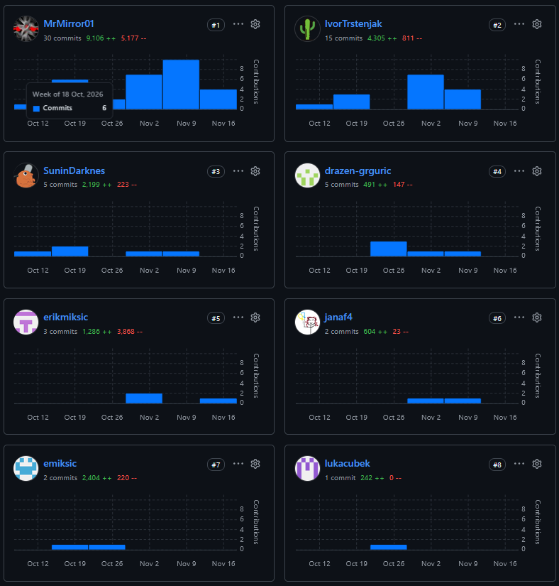

# A. Pregled aktivnosti grupe

**Cilj:** Prikazati kako je tim organizirao projekt, raspodijelio rad, reagirao na važne probleme i pridonio rezultatu. Zapisi trebaju opisivati ishode, a ne samo navoditi da je sastanak održan ili da se o nekoj temi raspravljalo.

## A.1 Evidencija sastanaka

**Cilj:** Voditi kratak zapis projektnih sastanaka i tjedne koordinacije: tko je sudjelovao, što je odlučeno i koja je radnja uslijedila. Raspravu koja nije dovela do odluke zabilježite samo ako je važno pitanje ostalo otvoreno.

| Datum i sudionici | Glavna tema | Donesena odluka ili zadatak  | Poveznica na zadatak ili  rezultat, ako postoji |
| --- | --- | --- | --- |
| 12.10.2026. | Formiranje tima, osnovne informacije |  |  |
| 22.10.2026. | Raspisivanje Issue-a na GitHub-u, podjela uloga, dogovor formata dokumentacije | | [Issues](https://github.com/SuninDarknes/izLETI/issues) |
| 29.10.2026. | Određivanje funkcijskih zahtjeva | Funkcijskim zahtjevima potrebno odrediti prioritete | [zahtjevi](./2-Analiza-zahtjeva.md) |
| 6.11.2026. | Dogovor o izvedbi postavljanja stranice te potrebnih funkcionalnosti na prvoj predaji |  | |
| 12.11.2026. | Dogovor o završnim poslovima na alpha verziji | |

## A.2 Plan rada

**Cilj:** Prikazati planirani redoslijed rada i odgovornosti u timu. Prikažite projektne tjedne ili druga kratka razdoblja koja tim koristi, uključujući pripremu za formalne provjere.

**Trenutačni plan:** [plan rada po tjednima izveden iz discorda](./Tjedni_plan_rada_iz_discorda.md)

## A.3 Aktivnosti i doprinosi članova

**Cilj:** Prikazati koji su članovi radili na važnim projektnim aktivnostima i približan trud koji prijavljuju. Uz implementaciju uključite oblikovanje, dokumentaciju, integraciju, ispitivanje i postavljanje.

| Aktivnost ili rezultat | Član | Prijavljeni sati | Reprezentativni rezultat ili poveznica |
| --- | --- | --- | --- |
|  |  |  |  |

Koristite aktivnosti specifične za projekt umjesto obaveznog retka za svako poglavlje dokumentacije ili svaki UML dijagram. Tim treba dosljedno bilježiti sate i izbjegavati dvostruko brojanje zajedničkog rada; reprezentativni rezultat objašnjava što je prijavljeni trud proizveo. Sati su samoprijavljena procjena uloženog rada, a ne mjera kvalitete niti zamjena za pregled koda i artefakata.

<strong>Primjer aktivnosti i rezultata rada</strong>

**Primjer — CrisisMap:** Tablica razlikuje implementaciju, integraciju i dokumentaciju te svaku aktivnost povezuje s rezultatom.

| Aktivnost ili rezultat | Član | Prijavljeni sati | Reprezentativni rezultat ili poveznica |
| --- | --- | --- | --- |
| Ručni unos položaja na karti | AK | 8 | Zadatak #21; promjena klijentskog dijela. |
| Provjera valjanosti i trajna pohrana prijave | LM | 10 | Zadatak #23; promjena pozadinskog sustava i ispitivanje. |
| Integracija klijenta i API-ja te javno postavljanje | EP | 7 | Zadatak #25; konfiguracija u `render.yaml` i `dist/` |
| Obrazac uporabe za podnošenje prijave i provjera odbijenog dopuštenja | NK | 5 | Završene izmjene UC-002 i ispitivanje ST-03. |

**Trud i rezultat:** Završni stupac omogućuje raspravu o doprinosu bez tretiranja velikog broja sati kao dokaza isporuke. Tim može prijaviti stvarno dugotrajan, još neriješen problem integracije kao obavljen rad i iskreno opisati njegov ishod.

## A.4 Pregled promjena u repozitoriju

**Cilj:** Prikazati kada su promjene napravljene u repozitoriju i tko ih je napravio, uz napomenu da sam broj zapisa promjena ne mjeri kvalitetu doprinosa.

**Prikaz aktivnosti repozitorija:** [LINK NA LIVE VERZIJU](https://github.com/SuninDarknes/izLETI/graphs/contributors?all=1)
 

Graf loše prikazuje ili ne prikazuje slijedeće stavke:
- Jakov Biškup (MrMirror01) bio je zadužen za merge-anje grana zbog ćega ima veći broj commitova i linija koda
- Florijan Gotal (SuninDarkness) radio je na postavljanju stranice te većina tog posla nije vidljiva na GitHub repozitoriju
- Erik Mikšić zabunom je koristio dva account-a za pristup repozitoriju pa je statistika podijeljena
- Jana Furdi radila je na dizajnu stranice što nije vidljivo iz broja commit-ova i promjenjenih linija koda
- Luka Čubek bio je zadužen za ispitivanje i planiranje što nije direktno vidljivo iz statistika

## A.5 Ključni inženjerski izazovi i rješenja

**Cilj:** Dokumentirati stvarne tehničke i organizacijske prepreke s kojima se tim suočio, poduzete korektivne inženjerske korake te konačni ishod. Odaberite konkretne izazove umjesto općenite pohvale timskog rada.

| Izazov | Poduzeta radnja | Ishod ili preostalo ograničenje |
| --- | --- | --- |
|  |  |  |

<strong>Rješavanje nesklada formata lokacije</strong>

**Primjer — CrisisMap:**

| Izazov | Poduzeta radnja | Ishod ili preostalo ograničenje |
| --- | --- | --- |
| Odabrani položaj na karti prikazivao se u klijentu, ali podnesena prijava nije zadržavala koordinate. | AK i EP usporedile su zahtjev preglednika s poljima lokacije koje očekuje API; AK je uskladila format zahtjeva, a LM je dodao provjeru valjanosti lokacije. | Nova prijava u ovom se scenariju može dohvatiti sa spremljenim položajem; tim povezuje odgovarajuću promjenu integracije i provjeru. |

**Problem, odgovor i ishod:** Svaki se dio može provjeriti u projektu. Rečenica poput „imali smo poteškoće s integracijom i riješili ih timskim radom” ne bi čitatelju rekla što nije radilo ni kako je rješenje promijenjeno.

---

>**Završna provjera:** Sastanci navode smislene ishode i odgovorne osobe; plan odražava namjeravani rad; tablica uloženog rada i generirani prikaz repozitorija odnose na ovaj vidljivi projekt; konkretni izazovi povezani su s radnjama i njihovim rezultatima. 